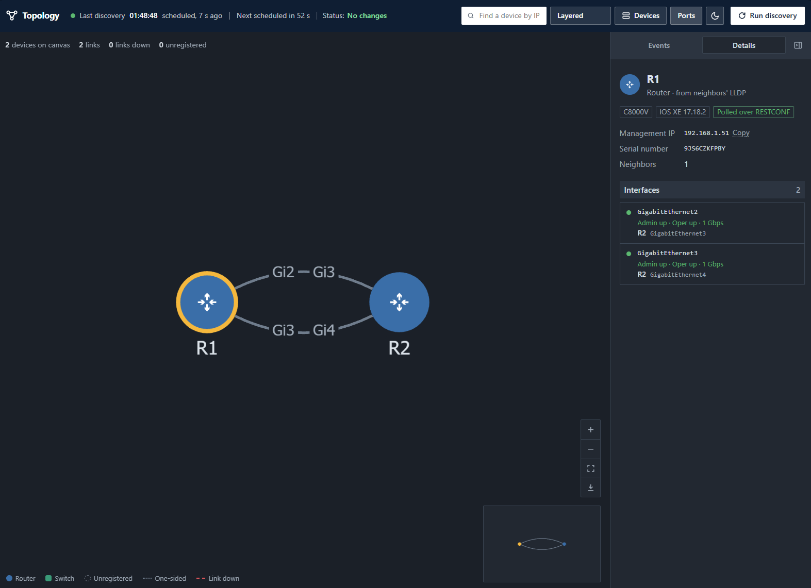
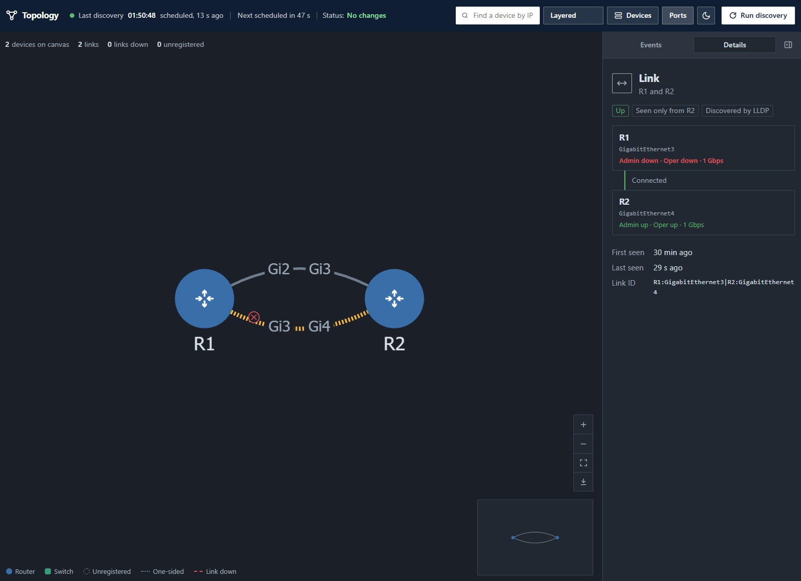
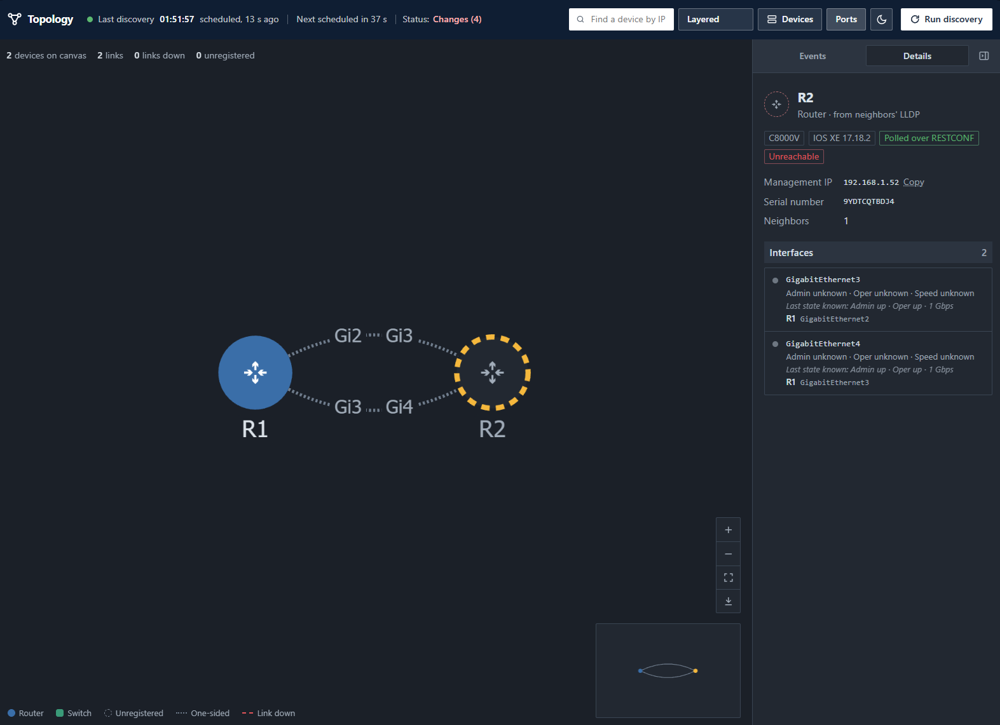
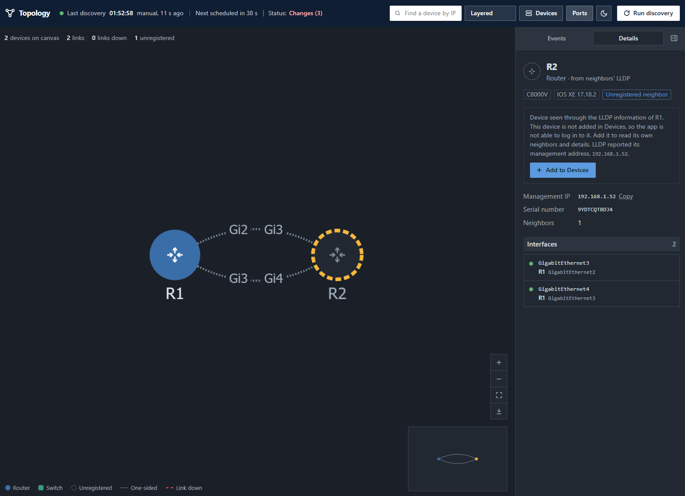
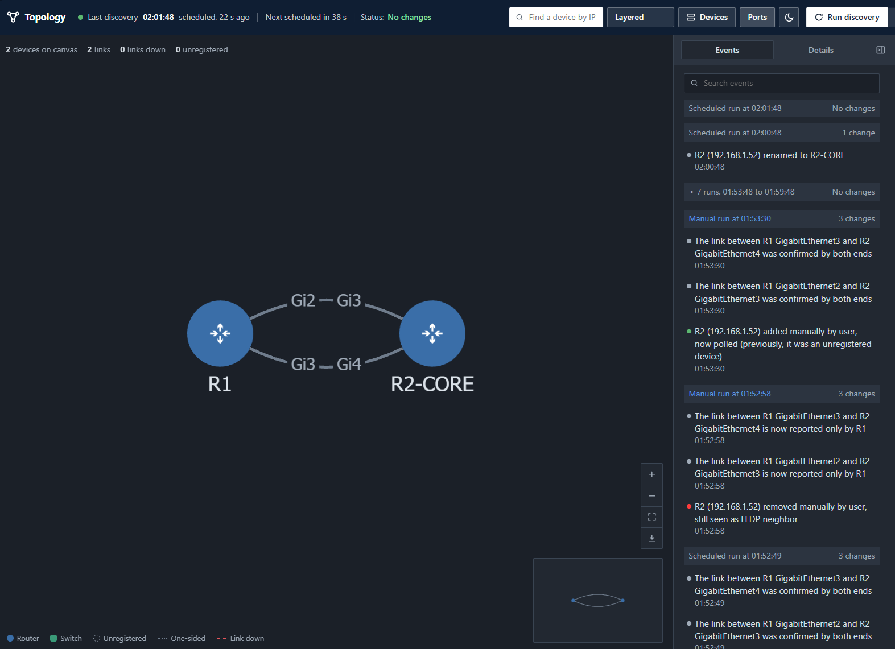
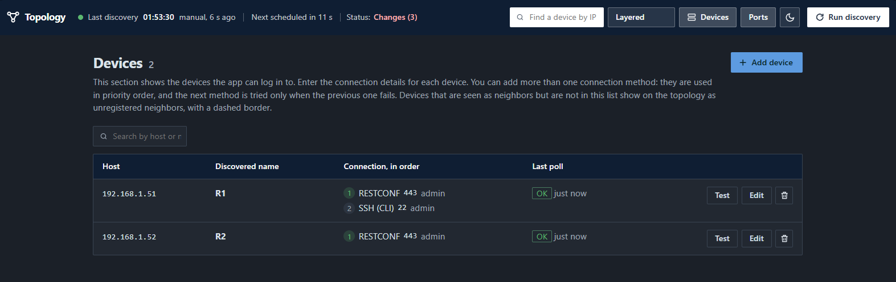
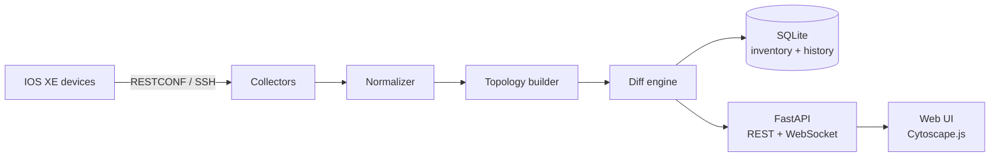
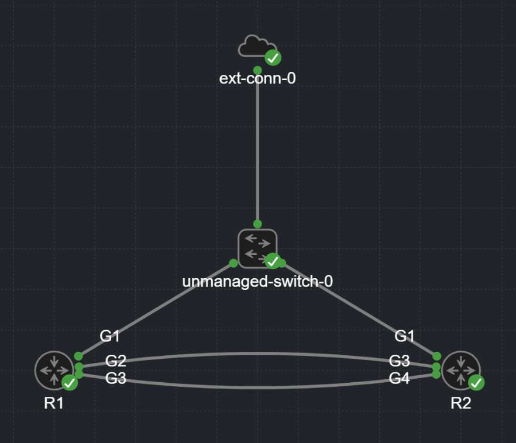

# Topology Viewer


Topology Viewer discovers network devices and links automatically with LLDP and draws a live, interactive map of the network. It reads the devices over RESTCONF (YANG models) and falls back to SSH when RESTCONF is not available. When a link goes down, a device stops answering or a hostname changes, the map and the event timeline update on their own.

It was built and tested on Cisco Modeling Labs (CML 2.10) with Catalyst 8000V routers running IOS XE 17.18.



## Features

- **Automatic discovery.** Every minute (or on demand) the backend polls the registered devices, reads their LLDP neighbors and builds the graph. Neighbors that are not registered appear as dashed nodes and can be added with one click.
- **RESTCONF first, SSH as fallback.** Each device has connection methods in priority order. If RESTCONF fails, the next poll uses SSH (Netmiko and TextFSM templates) and the event says so.
- **Change events.** Each run is compared with the previous one. Events cover devices added, removed, renamed, unreachable and reachable again, links down and up, links seen from one side only, and interface changes (admin, oper, speed).
- **Honest state.** When a device stops answering, its interfaces show `unknown` with the last known state below, instead of old data shown as current.
- **Link details.** Each link shows the interfaces at both ends and which ends confirm it over LLDP. Parallel links are drawn as separate curves in a fixed order. A down end is marked with a red cross, also in the PNG export.
- **Inventory in the UI.** Devices, connection methods and credentials are managed from the Devices page. Passwords are encrypted at rest and never returned by the API.
- **Canvas tools.** Four layouts, saved positions, minimap, search by hostname or IP, legend filters, light and dark themes, PNG export.

| Link down, with the cause in the event | Device not answering |
|---|---|
|  |  |

| Unregistered LLDP neighbor | Hostname changed |
|---|---|
|  |  |

The Devices page lists each device with its connection methods in priority order and the result of each one on the last poll:



## How it works



1. **Collectors** return the same report for every protocol: hostname, platform, interfaces and LLDP neighbors. RESTCONF uses `Cisco-IOS-XE-lldp-oper` and `Cisco-IOS-XE-interfaces-oper`; SSH uses `show lldp neighbors detail` and `show interfaces`. A new protocol (NETCONF, SNMP) is one more collector.
2. **The normalizer** makes interface names and platform strings comparable (`Gi2` and `GigabitEthernet2` are the same port).
3. **The topology builder** merges the two LLDP reports of each link into one link and records which ends saw it. It ignores neighbors learned on interfaces that are down, keeps a down link on the map for a few runs so the failure stays visible, and detects renamed devices by their management address.
4. **The diff engine** compares the new topology with the previous one and turns the differences into events. Runs with changes are kept longer than runs without them.
5. **The API** serves the topology and the history, and pushes each finished run to the browser over a WebSocket.

Polling runs with asyncio and a concurrency limit, so slow or dead devices do not block the others.

## Quick start with Docker

Requires Docker with Compose v2.

```powershell
git clone https://github.com/mvarrone/topology-viewer.git
cd topology-viewer
Copy-Item backend\.env.example backend\.env
docker compose up -d --build
```

Open http://localhost:5173, go to **Devices** and add a device with its management IP, username and password. The API and its documentation are at http://localhost:8000/docs.

- `frontend`: the built UI served by nginx, which also forwards `/api` and `/ws` to the backend.
- `backend`: FastAPI on uvicorn, with a health check. Both containers run as non-root users.
- Data (database, encryption key, node positions) lives in the `topology-data` volume. `docker compose down -v` deletes it.
- Set `SECRET_KEY` in `backend/.env` to choose the key that encrypts the device passwords. Without it, the backend creates one inside the volume.

## Preparing the devices

The devices need a local user, RESTCONF (or SSH) and LLDP. A minimal IOS XE configuration:

```
username admin privilege 15 secret <password>
aaa new-model
aaa authentication login default local
aaa authorization exec default local
!
ip http secure-server
ip http authentication local
restconf
!
lldp run
!
ip ssh version 2
crypto key generate rsa modulus 2048
line vty 0 4
 transport input ssh
```

Disable LLDP on the management interface (`no lldp transmit` and `no lldp receive`) so the management switch does not show up as a neighbor. The `lab/` folder has a full CML topology and the configuration of each node.

## Local development

Backend (Python 3.14):

```powershell
cd backend
py -3.14 -m venv .venv
.venv\Scripts\Activate.ps1
pip install -r requirements.txt
Copy-Item .env.example .env
uvicorn app.main:app --reload
```

Frontend (Node.js 20.19 or newer):

```powershell
cd frontend
npm install
npm run dev
```

The Vite dev server on port 5173 forwards `/api` and `/ws` to the backend on port 8000.

## API

| Endpoint | Purpose |
|---|---|
| `GET /api/topology` | Current devices and links |
| `GET /api/devices`, `GET /api/links` | Devices and links on their own |
| `GET /api/devices/{id}` | One device and its links |
| `GET /api/discovery/status` | Running run, last run, next scheduled run |
| `GET /api/discovery/runs` | Run history (`include_diff=true` adds the changes) |
| `POST /api/discovery/run` | Start a manual run |
| `GET`, `POST /api/inventory` | List devices, add a device |
| `GET`, `PUT`, `DELETE /api/inventory/{id}` | Read, update or remove a device |
| `POST /api/inventory/{id}/test` | Test each connection method of a device |
| `GET`, `PUT /api/positions` | Saved canvas positions |
| `WS /ws/topology` | Snapshot on connect, then one message per run |

## Tested scenarios

All of these were run on a two router CML lab: two Catalyst 8000V routers (R1 and R2) with two parallel links, and management through an unmanaged switch and an external connector to the host network.




| Scenario | Result |
|---|---|
| Neighbor not registered | Shown as a dashed node; the link is marked as seen from one side |
| Add the neighbor from its details | Host filled from LLDP; the link becomes confirmed by both ends |
| Two parallel links | Two separate links with the right interfaces at each end |
| Link stopped and started | Link down with the reason, then up and confirmed again |
| `shutdown` on an interface | Down end marked with a cross; interface state updated |
| Management interface down | Device unreachable, interfaces `unknown`; reachable again with the outage window |
| LLDP transmit disabled on one end | Link reported from one side only |
| Hostname changed | One rename event; links and position kept |
| Wrong RESTCONF password | Device polled over SSH; back to RESTCONF once fixed |
| Backend restart | UI reconnects; topology and events kept |

## Project layout

```
backend/        FastAPI app: collectors, discovery service, inventory, history
frontend/       Vite + TypeScript UI with Cytoscape.js
lab/            CML topology and device configurations
scripts/        restconf_probe.py: dump RESTCONF responses from a device
docker-compose.yml
```

## Roadmap

- Ansible playbooks to prepare the lab devices, with a dynamic inventory read from the API
- NETCONF and SNMP collectors, CDP neighbors
- NX-OS and other operating systems
- MAC address tables and device inventory
- Streaming telemetry instead of polling

## License

Released under the [MIT License](LICENSE). You can use, change and share the code, keeping the copyright notice.

Made by **Matias Varrone**. Questions and suggestions are welcome in [Issues](https://github.com/mvarrone/topology-viewer/issues).
